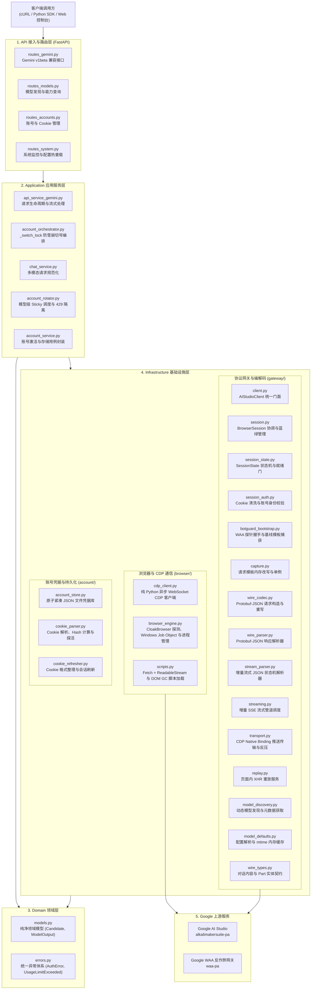
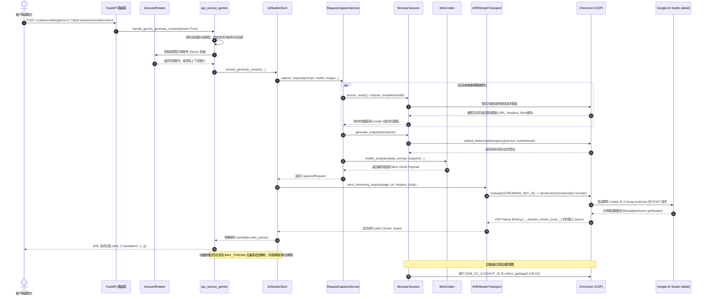

# aistudio-api 系统架构设计

本文档说明 `aistudio-api` 的模块职责、请求生命周期和资源约束。实现与离线回归测试是行为依据；运行配置、账号数据和发布记录不属于源代码。

---

## 目录

- [1. 整体架构与分层设计](#1-整体架构与分层设计)
- [2. 核心模块与职责划分](#2-核心模块与职责划分)
- [3. 请求生命周期与执行时序](#3-请求生命周期与执行时序)
- [4. 并发控制与高可用设计](#4-并发控制与高可用设计)
- [5. 跨平台支持与依赖隔离](#5-跨平台支持与依赖隔离)
- [6. 修改入口与验证](#6-修改入口与验证)

---

## 1. 整体架构与分层设计

系统采用分层设计（Layered Architecture），划分为 **API 接入层**、**Application 应用服务层**、**Domain 领域层** 与 **Infrastructure 基础设施层**：

---

## 2. 核心模块与职责划分

### 2.1 API 接入层 (`src/aistudio_api/api/`)

| 文件 | 核心职责 |
|---|---|
| `routes_gemini.py` | 对外暴露 `/v1beta/models/{model}:generateContent` 和 `:streamGenerateContent` 端点 |
| `routes_models.py` | 动态向上游拉取并缓存可用模型列表（如 `gemini-3.7-flash`、`gemini-3.8-flash` 等） |
| `routes_accounts.py` | 提供 Cookie 单条/Bundle文件导入、多账号递归探活（`u/0`, `u/1`...）、手动激活与删除接口 |
| `routes_system.py` | 公开最小健康状态、受管理认证保护的监控指标与配置接口 |
| `dependencies.py` | 分离管理密码和模型调用密钥；模型支持 Query 参数 `?key=`、Header `x-goog-api-key`、`x-api-key` 或 `Bearer`，空调用密钥配置拒绝请求 |

### 2.2 应用服务层 (`src/aistudio_api/application/`)

| 文件 | 核心职责 |
|---|---|
| `chat_service.py` | 将客户端提交的 Gemini 请求转换为内部结构，处理 Base64 媒体、系统提示与工具参数声明 |
| `account_rotator.py` | 负责多账号的 Sticky 黏性调度，按模型维护 429 限流与 403 鉴权异常隔离状态，每日美西午夜重置 |
| `account_orchestrator.py` | 提供全局防雪崩互斥锁（`_switch_lock`），在并发 429 与 403 异常时实现安全有序故障转移切号与单账号在位自愈 |
| `account_service.py` | 账号领域用例（Cookie 保存、批量探活导入、凭据激活）封装，杜绝路由层穿透访问存储私有属性 |
| `api_service_gemini.py` | 编排请求全生命周期，协调捕获模板、签名、传输重放及 SSE 流式响应 |
| `model_selection.py` | 将 `抗截断/<base>` 选择器映射为原模型，保持账号准入、冷却、模板与统计共用原模型身份 |
| `continuation.py` | 仅在真实 `MAX_TOKENS` 完成后执行有界续写；保留每轮 Part、签名和对话边界，累计用量 |
| `inference_limits.py` | 限制推理并发、等待队列和排队时长；取消及退出时释放名额 |

### 2.3 领域模型层 (`src/aistudio_api/domain/`)

| 文件 | 核心职责 |
|---|---|
| `models.py` | 纯净领域数据结构定义（`Candidate`, `ModelOutput`, `GeneratedImage`），杜绝外部协议与 Protobuf 数组下标耦合 |
| `errors.py` | 统一异常体系定义（`SessionExpiredError`, `AuthError`, `UsageLimitExceeded`, `RequestError` 等） |

### 2.4 基础设施层 (`src/aistudio_api/infrastructure/`)

- **浏览器与 CDP 子系统 (`browser/`)**：
  - `cdp_client.py`：Chrome DevTools Protocol 异步客户端，负责 WebSocket 通信、网络过滤与目标管理。命令发送和回包共享期限；连接关闭时解除等待并回收异步事件任务。
  - `browser_engine.py`：Chromium 路径探测、参数组装与进程/端口生命周期管理（支持 Win32 API 与 Linux 容器环境）。
  - `scripts.py`：浏览器端注入脚本加载器。
  - `js/`：浏览器端独立脚本，包含 Hook 注入、流式通信、快照签名与内存清理。
- **网关与编解码子系统 (`gateway/`)**：
  - `client.py`：`AIStudioClient` 统一门面，组装请求重放、流式生成与会话生命周期。
  - `session.py`：`BrowserSession` 协调核心，管理会话生命周期、蓝绿标签页平滑热切及快照签名生成。
  - `session_state.py`：会话状态机（`SessionState`）、就绪门（`SessionReadinessGate`）及上下文描述符（`SessionContext`），支持并发请求阻塞等待与瞬时唤醒。
  - `session_auth.py`：Cookie 过滤清洗（剔除 `OSID`、`SIDCC` 冲突项）、登录页重定向感知、邮箱身份探测与凭据原子落盘。
  - `botguard_bootstrap.py`：BotGuard WAA 握手、基础请求模板拦截与临时会话管理。
  - `wire_spec.py`：Protobuf-over-JSON (JSPB) 字段索引枚举与 `JspbArray` 稀疏容器定义。
  - `wire_codec.py`：JSPB 请求结构组包、参数动态改写与内置工具注入。
  - `wire_parser.py`：JSPB 响应解析器，处理 Struct 结构体、ListValue 数组与状态码映射；合法元数据块中的默认状态不抹除已取得的完成原因。
  - `wire_types.py`：领域数据结构契约（`AistudioContent`、`AistudioPart`、`AistudioGenerationConfig`）。
  - `stream_parser.py`：流式 JSON 增量状态机解析器，去除 XSSI 前缀并按括号深度切片分块。
  - `transport.py`：基于 CDP Binding 的事件推送管道，支持队列反压控制与时间戳签名注入。
  - `capture.py`：请求模板缓存与纯内存模型适配。
  - `replay.py`：页面上下文 XHR 请求重放与异常降级。
  - `streaming.py`：流式响应分发与异常映射。
  - `model_discovery.py`：可用模型列表动态探测与本地降级。
  - `model_defaults.py`：模型默认规则解析与 mtime 驱动的内存缓存。
- **账号与持久化子系统 (`account/`)**：
  - `account_store.py`：串行读改写注册表，仅在原子落盘成功后发布内存快照；注册表不可读或格式错误时拒绝写入，避免当作空账号覆盖。账号写入失败时恢复本次涉及的凭据与元数据文件，恢复过程与会话检查点共用文件锁；不保证断电或持续存储故障下的跨文件事务。
  - `cookie_parser.py`：Cookie 格式解析、SAPISIDHASH 计算与多子账号探测。
  - `cookie_refresher.py`：Cookie 凭据规整与会话保活刷新。

## 3. 请求生命周期与执行时序

从客户端请求到获取流式响应的端到端调用时序：

---

## 4. 并发控制与高可用设计

### 4.1 单进程受控 Chromium 架构

- 全局维持 **单个受控 Chromium 进程**，避免多实例多进程导致的内存膨胀。
- 启动限制参数：`--renderer-process-limit=1`、`--js-flags=--max-old-space-size=128 --expose-gc`、`--disable-gpu`。
- 并发请求通过 CDP 客户端在同一个浏览器页面上下文内以轻量 `Fetch + ReadableStream` 执行，并由 `DOM_GC_CLEANUP_JS` 与 V8 原生垃圾回收控制内存占用。

### 4.2 模型独立限流、403 鉴权隔离与 Sticky 调度

- **模型级配额隔离**：各账号针对不同模型（如 `gemini-3.7-flash`、`gemini-3.8-flash`）的 429 状态独立记录，单模型额度耗尽不影响其他模型的正常调用。
- **403 鉴权异常快速隔离**：当账号遭遇 `The caller does not have permission` (403) 异常时，调度器立即对该账号设置短时隔离（`auth_cooldown`），优先调度至健康备用账号。
- **Sticky 黏性调度**：默认保持当前活跃账号，直到该账号针对当前模型遭遇 429 限流或 403 异常时，才自动顺延切换至下一个健康账号。
- **并发结果归属**：成功和失败归属请求实际使用的账号；旧请求晚到的成功结果不得清除其他在途请求刚设置的有效冷却。
- **自动配额重置**：按 `America/Los_Angeles` 当地午夜重置 RPD 计数，自动处理夏令时；对应北京时间会随季节变化。成功、限流及其他失败均记入同一当地日期的请求计数，账号统计页面也刷新未再次调用模型的旧日计数；累计总数与登录态隔离保持独立。

### 4.3 防切号雪崩互斥锁 (`_switch_lock`) 与自愈

当多个并发协程同时遭遇 429 限流或 403 权限异常时：
1. 率先获得 `_switch_lock` 的协程执行实质性切号与页面上下文刷新；
2. 后续排队获得锁的协程通过双重检查（Double-Checked Locking），识别到账号已被切换至健康账号且对当前模型可用，直接复用重试，避免并发异常导致多次无谓切号；
3. 需要会话恢复时，在满足错误类型和在途租约约束后刷新模板或上下文。Google 已撤销或过期的凭据需要重新提供，代码刷新无法恢复其有效性。
### 4.4 蓝绿会话平滑热切与就绪门机制 (Blue-Green Session Transition)

针对多账号并发场景，系统实现了无锁化原子就绪门（`SessionReadinessGate`）与蓝绿标签页热切：
1. **独立新标签页隔离初始化**：当触发账号轮换时，网关在后台并发创建新 CDP 标签页，注入新账号 Cookie，导航至目标子路由 `/u/{auth_user}/` 并完成 WAA 挑战握手；
2. **原子门禁切换**：握手就绪后，`SessionReadinessGate` 原子切换至新 `SessionContext`，状态置为 `READY`，瞬间放行排队中的新请求；
3. **旧会话平滑排干 (Drain)**：旧账号上下文移入退休队列，在途请求继续使用原有标签页；当计数归零（`in_flight == 0`）触发 `drain_event` 后再销毁。崩溃、取消和上游断连仍按错误返回，不能把部分正文标记成成功。

### 4.5 流式响应与自动续写的边界

- 流式和非流式共享生成块结构检查。HTTP 200、合法 JSON 外层或早先的完成标记，均不能掩盖后续非法生成块。
- 只有完整传输及真实完成原因才能结束响应。首个内容片段发出后不重放原请求；安全阻止、网络错误和未知协议内容不会触发自动续写。
- 抗截断模式保留最多 512 KiB 的续写片段，输入历史估算预算为 1 MiB；最多两轮额外请求共享一个总期限及账号租约。工具声明和策略不变，实际工具、代码、多模态或其他无法回放的载荷停止追加轮次。
- 内部续写保留每轮独立的模型/用户历史及每个 Part 的签名。客户端收到的是合并回答；需要跨请求完整重放带签名历史的客户端，应使用普通模型并自行管理续写。
- 续写轮次合并登记一次成功，成功返回的 Token 用量累计所有上游轮次；错误重试仍登记相应失败和成功事件。因此统计中的请求数既不等于客户端请求数，也不等于上游实际调用次数。

## 5. 跨平台支持与依赖隔离

| 平台 | 运行模式 | 浏览器后端 | 内存基准 |
|---|---|---|---|
| **Android (Termux)** | `proot-distro` Linux 容器隔离运行 | CloakBrowser (aarch64) | 约 350 - 450 MB PSS（建议空闲 RAM ≥ 1 GB） |
| **Linux (x86_64 / arm64)** | 原生宿主运行 | CloakBrowser (x86_64 / arm64) | 约 250 - 350 MB PSS |
| **macOS (Apple Silicon / Intel)** | 原生宿主运行 | CloakBrowser | 约 250 - 350 MB |
| **Windows (x64)** | 原生宿主运行 (Job Object 进程管理) | CloakBrowser (x64) | 约 280 - 380 MB |
| **Docker 容器** | Debian 基础镜像 (amd64 / arm64) | 容器内置 CloakBrowser (`/opt/cloakbrowser/chrome`) | 约 250 - 350 MB |
> 依赖管理使用 `uv`。由于 PyPI 官方未提供 Android 预编译 wheel，而 Termux 的 TUR 源缺少桌面端 wheel，因此 `uv.lock` 不纳入版本控制：桌面端直接从 PyPI 安装对应 wheel；Termux 环境通过本地 `uv.toml` 使用 TUR 源，避免不同平台的 wheel 源锁定冲突。

## 6. 修改入口与验证

| 变更范围 | 优先检查的位置 | 必须保留的行为 |
|---|---|---|
| 认证与配置 | `api/dependencies.py`、`api/routes_system.py`、`infrastructure/utils/config_store.py` | 管理/调用权限分离，原子保存且保留未编辑字段；日志级别与布尔值写前验证，持久化成功后才应用运行设置 |
| 账号与配额 | `application/account_rotator.py`、`account_orchestrator.py`、`gateway/session.py` | 统计归属原账号、模型冷却独立、退休上下文等待租约释放 |
| 生成与续写 | `application/chat_service.py`、`continuation.py`、`gateway/wire_parser.py`、`streaming.py` | Schema 的零值约束保留、Part 顺序与签名保真、真实完成、预算有界、不重放已发出的内容 |
| 浏览器通信 | `browser/cdp_client.py`、`gateway/transport.py`、`browser/js/` | 同一期限覆盖发送与等待，断连/取消清理队列、任务和请求 |
| HTTP 诊断 | `api/app.py`、`api/error_middleware.py` | 摘要只记录固定操作名与异常类型，未处理异常返回通用 500，并保留安全的内存诊断；取消继续向外传递 |
| 管理界面 | `web/src/`、`tests/frontend/` | 旧响应不覆盖新快照；文件读取与保存只更新当前弹窗和草稿；模型草稿接收未编辑的日志设置刷新，保留明确编辑的 YAML；卸载取消读取，浏览器状态串行且仅在可见时轮询 |

使用已配置的 Python 环境运行 `python scripts/run_tests.py`。该入口在导入前隔离配置、账号、统计与临时目录并禁用 dotenv；测试中的启动和浏览器路径使用合成响应及替身。Windows 自动排除两项 Linux 专用测试，Linux CI 运行完整检查。

Python 代码运行 `python -m ruff check .` 和 `python -m pyright`。前端在 `web/` 按 `package.json` 运行 `npm run type-check`、`npm run lint`、`npm run test:frontend` 和 `npm run build`；不手工编辑静态构建产物。

发布通过受保护分支上的 CI、固定提交制品和既定部署工作流完成，保留上一代码版本并验证健康及认证。模型目录发现也可能访问 Google，因此部署验证不查询生产模型目录、不激活账号或调用真实模型。配置、浏览器数据、密钥及统计留在发布目录之外；回滚只切换代码。
